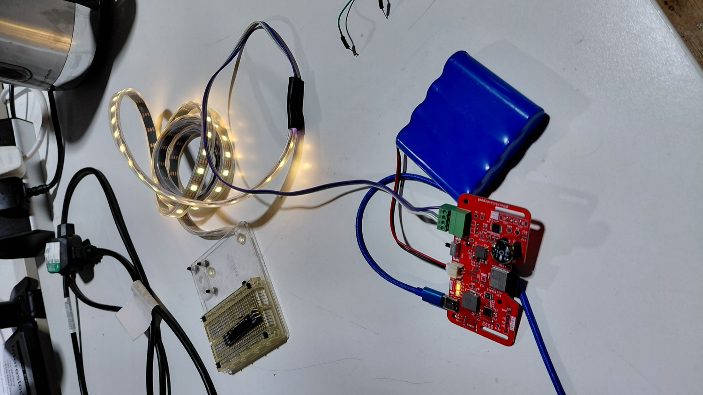

# LED Blink

> ESP32 addressable RGB LED example using FastLED and a WS2812B strip, with Arduino firmware and a build video.

[][yt]
[][tt]
[][ig]

## What it does

Lights up individual pixels on an addressable RGB and cycles them through colours on a timer. A starting point for getting FastLED talking to a WS2812B panel before doing anything more interesting with it.

## Materials

| Qty | Component | Part | Notes |
| --- | --- | --- | --- |
| 1 | Microcontroller | ESP32 | Custom board, LED connector built in |
| 1 | LED Strip | WS2812B | Addressable RGB |
| 1 | USB | USB C Data Cable | Power and flashing |

## Firmware

- Board: ESP32
- Libraries: [FastLED][fastled]
- Flash: open `main.ino` in Arduino IDE, select the board, upload.

Brightness is capped at 50/255 in `setup()`.

## Build Log

I documented this on [YouTube][yt-1].

## Notes

The ESP32 is a custom board built by someone at DoES Liverpool, with a connector the LED strip plugs straight into, so 5V, ground and data all come off that one plug.

I originally started this as a sound-reactive build, but the ESP32 I used had been custom built with a digital microphone, and I didn't get time to work out the digital-to-analogue side. The sound sensor path is still in `main.ino`, commented out. GPIO34 was the ADC input if it comes back.

Data is on GPIO5 (`LED_PIN` in `main.ino`). If you rebuild this on a stock dev board, that's the pin the strip's DIN goes to, with 5V and GND to the strip's power pads.

## Licence

MIT, see [LICENSE](LICENSE).

---

This build on [YouTube][yt-1] · [TikTok][tt-1] · [Instagram][ig-1] · [project page][portfolio]. All projects at [github.com/TikitaTolley][gh].

[yt]: https://youtube.com/@tikitatech
[tt]: https://tiktok.com/@tikitatech
[ig]: https://instagram.com/tikitatech
[gh]: https://github.com/TikitaTolley
[portfolio]: https://tikitatech.xyz/projects/led-blink/

[fastled]: https://github.com/FastLED/FastLED

[yt-1]: https://www.youtube.com/shorts/5NtJvw59SqI
[tt-1]: https://www.tiktok.com/@tikitatech/video/7670122221767118102
[ig-1]: https://www.instagram.com/tikitatech/reel/Dbl4Sl8q-0P/
